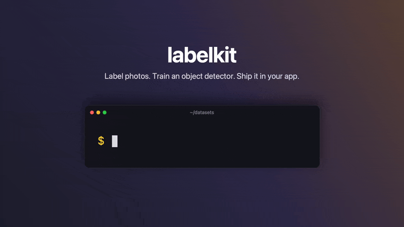

<h1 align="center">
  <br>
  labelkit
</h1>

[](https://github.com/shellbear/labelkit/releases/latest)
[](https://github.com/shellbear/labelkit/actions/workflows/ci.yml)
[](https://github.com/shellbear/labelkit/releases/latest)
[](LICENSE)

A native macOS bounding-box annotator for **Apple Create ML object-detection
datasets** — launched from the terminal, no project files, no accounts, no
format conversion.



<sub>Label, train, auto-label — 38 seconds. Demo photos from Wikimedia Commons, CC BY / CC BY-SA: [credits](docs/demo-credits.md).</sub>

```
labelkit path/to/dataset
```

Your images appear with their existing boxes. Edit, hit ⌘S, and your
`annotations.json` is updated in place — byte-stable, git-diff friendly.

## Why

Create ML consumes a simple, documented JSON format — but nothing edits it
natively. Web annotators need drag-drop rituals and format conversion on
every session; the one native tool that round-trips the format is paid. If
your dataset lives in git next to your training scripts, you want a tool
that treats the JSON as the source of truth and leaves everything else alone.

labelkit's contract:

- **Filenames are never touched.** Whatever `"image"` says is what gets saved.
- **Negatives survive.** Entries with zero annotations are training signal,
  not garbage — they round-trip. Deleting a box down to zero keeps the entry.
- **Unknown keys survive.** Extra fields on entries or annotations
  (`imageWidth`, custom metadata, …) are preserved verbatim.
- **Canonical output.** Stable key order, 2-decimal coordinates, 2-space
  indent, trailing newline — the same input always saves to the same bytes,
  so your `git diff` shows only real changes.
- **Scales.** Tens of thousands of images open instantly; thumbnails decode
  lazily with a hard memory budget (a 10k-image dataset idles around ~20 MB).

## Install

### Homebrew

```bash
brew install shellbear/tap/labelkit
```

### Download a binary

Latest release — a universal build, or a smaller per-arch slice:

| Mac | Download |
|---|---|
| Apple Silicon | [`labelkit-arm64.tar.gz`](https://github.com/shellbear/labelkit/releases/latest/download/labelkit-arm64.tar.gz) |
| Intel | [`labelkit-x86_64.tar.gz`](https://github.com/shellbear/labelkit/releases/latest/download/labelkit-x86_64.tar.gz) |
| Universal | [`labelkit-universal.tar.gz`](https://github.com/shellbear/labelkit/releases/latest/download/labelkit-universal.tar.gz) |

The builds are ad-hoc signed, so clear the quarantine flag on first run:

```bash
tar -xzf labelkit-*.tar.gz                             # → labelkit + labelkit.app (keep them together)
xattr -dr com.apple.quarantine labelkit labelkit.app   # ad-hoc signed → clear Gatekeeper
```

Every release ships SHA-256 checksums; see the
[releases page](https://github.com/shellbear/labelkit/releases) for all versions.

### From source

macOS 14+, Xcode 15+:

```bash
git clone https://github.com/shellbear/labelkit && cd labelkit
make install    # builds and installs into your Homebrew prefix (or /usr/local)
```

`make install PREFIX=~/.local` installs elsewhere; `make app` just builds —
the CLI and `labelkit.app` land in `.build/release/`, side by side (the CLI
launches through the sibling bundle, so keep them together).

## Usage

```bash
labelkit <folder>              # folder with images; annotations.json auto-detected,
                               # created on first save if absent
labelkit <labels.json>         # a Create ML JSON; images resolved next to it
labelkit                       # open panel
labelkit <folder> --annotations other.json   # explicit annotations path
labelkit <folder> --images '*.jpg'           # filter images by glob
labelkit <folder> --select IMG_0412.jpg      # open on that image (reloads if already open)
```

The same binary also works without the editor, for scripts and AI agents:

```bash
labelkit stats <folder>        # what is labelled and what isn't
labelkit annotate <folder> …   # write boxes
labelkit render <folder> …     # draw the boxes onto pictures to check them
labelkit validate <folder>     # find problems; exits 1 on errors
labelkit detect <image> …      # run a detector
labelkit train <folder>        # train a Core ML model
labelkit import <source> --into <folder>      # bring in a YOLO, COCO or Hugging Face dataset
labelkit export <folder> --format yolo --out <dir>   # …or write one out
```

## Using it from an AI agent

labelkit can be driven end to end from the terminal, so a coding agent can
label a dataset, check its own work, and hand it to you for review.

```bash
labelkit skill --install
```

That one command teaches Claude Code, Codex, opencode, Cursor, Gemini CLI,
GitHub Copilot, Amp, Goose and other clients how to use labelkit: it installs a
small [Agent Skill](https://agentskills.io) where each of them looks for one.
For an agent without skills, `labelkit skill --snippet >> AGENTS.md` adds a few
lines instead. Then just ask:

> Label the photos in `./cards` for object detection, one box per card.

What the agent runs is the same loop you could run by hand:

```bash
labelkit stats ./cards                                           # what's left to do
labelkit render ./cards --unlabeled --grid 100 --out /tmp/todo   # pictures with a pixel ruler
labelkit annotate ./cards --image IMG_0412.jpg --box 'card:412,230,318,455'
labelkit render ./cards IMG_0412.jpg --out /tmp/check            # look at the result
labelkit validate ./cards                                        # anything wrong?
labelkit ./cards --select IMG_0412.jpg                           # show you that image in the editor
```

- **Boxes go in the way your model gives them.** Gemini's `box_2d`, corner
  lists, 0–1 or 0–1000 coordinates, YOLO-style centres, COCO files and
  `labelkit detect` output are all accepted; you name the convention instead of
  converting numbers.
- **Safe to retry.** Running the same `annotate` twice changes nothing, and a
  run with any bad input writes nothing at all.
- **Still your file.** Scripted edits go through the same writer as the editor,
  so every guarantee under [Why](#why) holds and `git diff` shows only the boxes
  that changed.
- **Fast enough to loop on.** On 10,000 images, `stats` takes 0.2 s and
  `annotate` 0.1 s.

Stdout is JSON, stderr is notes, and exit codes are `0` ok, `1` problem found,
`64` usage error. No server and no MCP setup are involved.

**[Full guide: per-client setup, input formats, the JSON contract →](docs/agents.md)**

## Working with other tools and formats

A labelkit dataset is Apple's Create ML format and nothing more, so it moves
between tools with two commands:

```bash
labelkit import ./yolo-or-coco-download --into ./cards     # format detected; never overwrites; safe to repeat
labelkit export ./cards --format huggingface --out ./cards-hf
```

To see it on a real dataset in a minute, try COCO8, an 8-image sample of COCO
that Ultralytics publishes in YOLO format:

```bash
curl -LO https://github.com/ultralytics/assets/releases/download/v0.0.0/coco8.zip && unzip -q coco8.zip
curl -LO https://raw.githubusercontent.com/ultralytics/ultralytics/main/ultralytics/cfg/datasets/coco8.yaml
labelkit import coco8 --into coco8-ml --names coco8.yaml    # 8 images, 30 boxes, 12 classes
labelkit coco8-ml                                           # open it in the editor
```

(The zip carries no class names of its own, hence `--names`; without it the
boxes import as `class_0`, `class_1`, ….)

`import` and `export` cover **YOLO**, **COCO** and **Hugging Face** image
datasets. That gives you a few useful routes:

- **Start from a public dataset** instead of from nothing.
- **Publish or back up on Hugging Face**, public or private, with their `hf` tool.
- **Keep images in your own bucket** (R2, B2, S3) and only `annotations.json` in git.
- **Use a big model as a teacher**: let a YOLO or vision-language model label
  your images, review, then train a small on-device model with `labelkit train`.

**[Recipes for each of these →](docs/datasets.md)**

## Detecting from the CLI

`labelkit detect` runs an object detector over an image (or a whole directory)
and prints the boxes to stdout. It never opens the editor or touches the GUI —
same rule as `--version` — so it's safe to pipe, redirect, and script.

Pick exactly one detector: a custom Core ML model, or a built-in Apple Vision
detector (`rectangles`, `faces`, `humans`, `animals`, `saliency`).

```bash
labelkit detect photo.jpg --model cards.mlpackage             # custom Core ML model
labelkit detect photo.jpg --detector rectangles               # built-in Vision detector
labelkit detect ./images  --detector faces --format ndjson    # a directory, one JSON line per image
labelkit detect photo.jpg --model cards.mlpackage --render out.png   # also write an annotated PNG
```

Output is JSON by default (`--format json|ndjson|text`). Boxes are reported
twice — in image pixels and normalized `[0,1]`, **both top-left origin** — so
no consumer has to re-derive the coordinate convention:

```json
{
  "schemaVersion": 1,
  "detector": "Rectangles",
  "source": "vision",
  "image": "photo.jpg",
  "width": 2048,
  "height": 1536,
  "detections": [
    {
      "label": "card",
      "confidence": 0.9712,
      "box": { "x": 326.39, "y": 490.28, "width": 247.78, "height": 427.68 },
      "normalized": { "x": 0.15937, "y": 0.31919, "width": 0.121, "height": 0.27844 }
    }
  ]
}
```

Common options:

| Option | Meaning |
|---|---|
| `--model PATH` | custom Core ML model (`.mlmodel` / `.mlpackage` / `.mlmodelc`) |
| `--detector NAME` | built-in Vision detector (see list above) |
| `--format json\|ndjson\|text` | output shape (default `json`) |
| `--render PATH` | also write an annotated PNG — a file for one image, a directory for many |
| `--min-confidence 0–1` | drop detections scoring below this (default `0.5`) |
| `--label NAME` | label for localize-only detectors (`rectangles`, `faces`, …) |
| `--glob '*.jpg'` | which files a directory run picks up |
| `--max-pixel N` | longest edge to decode to before detection (default `1536`) |

Machine-readable output goes to stdout; progress and warnings go to stderr.

## Editing

| Action | How |
|---|---|
| Draw a box | drag on empty area |
| Select / move | click / drag a box |
| Resize | drag any of the 8 handles (drag past the opposite edge to flip) |
| Delete box | ⌫ |
| Change label | click a label in the inspector, or press 1–9 |
| New label | inspector text field |
| Undo / redo | ⌘Z / ⇧⌘Z (one drag = one undo step) |
| Previous / next image | ← / → (also ⌘↑ / ⌘↓) |
| Zoom | pinch, or ⌥ + scroll (anchored under the cursor) |
| Pan | two-finger scroll |
| Fit to window | ⌘0 |
| Save | ⌘S (you'll be prompted on quit if anything is unsaved) |

## Format

Apple Create ML object detection JSON — one file for the whole dataset,
coordinates are box **centers** in pixels, top-left origin. Official
references: Apple's [Building an object detector data
source](https://developer.apple.com/documentation/createml/building-an-object-detector-data-source)
(Create ML / `MLObjectDetector`) and the [Turi Create object detection
guide](https://apple.github.io/turicreate/docs/userguide/object_detection/),
which spells out the center-anchored coordinate semantics.

> Note on key names: Apple's `MLObjectDetector.DataSource` reference shows an
> `imagefilename`/`annotation` spelling, while the Create ML **app** and the
> wider ecosystem (Roboflow, RectLabel, …) use `image`/`annotations`.
> labelkit reads and writes the `image`/`annotations` variant — the one the
> Create ML framework accepts in practice and the ecosystem interchanges.

```json
[
  {
    "image": "photo-001.jpg",
    "annotations": [
      {
        "label": "card",
        "coordinates": { "x": 450.28, "y": 1075.12, "width": 247.78, "height": 427.68 }
      }
    ]
  },
  { "image": "background-only.jpg", "annotations": [] }
]
```

Notes:

- Entries whose image file is missing on disk are flagged in the sidebar and
  saved back untouched — datasets never silently shrink.
- EXIF orientation is applied everywhere, so coordinates always refer to the
  image as displayed (which is what Create ML expects).

## Roadmap

- A checksum manifest, so a dataset whose images live in a bucket can be
  verified after download
- The editor noticing when `annotations.json` changes underneath it

## License

MIT
